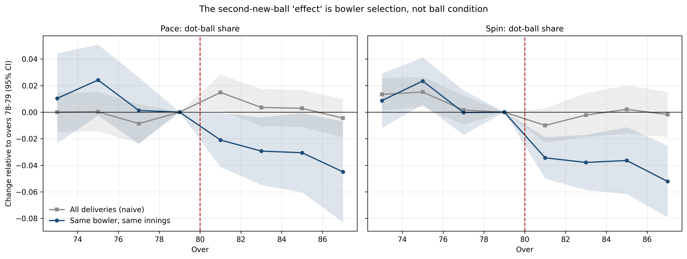

# Selection at the Boundary, Ambiguity in the Trend: What 6.8 Million Deliveries Can and Cannot Say About Pitch Wear

Aravind R, Rishab H R, and Ujwal S Nair

Department of Electronics and Communication Engineering
RVCE, Bengaluru, India

**Abstract—**Pitch wear is a first-order tactical variable in cricket and there is no public
measurement of it. The natural proxy is the within-match change in the relative
effectiveness of spin and pace, estimated from ball-by-ball data with match fixed
effects. Using 6.8 million deliveries from 18,585 matches, we show that this
proxy is precise and stable but not identified as wear. The verdict is mostly
negative. Within-innings permutation nulls are mis-centred — for one outcome by
more than the effect they are meant to test — so the usual randomisation
p-values are not usable; a null-imposed wild cluster bootstrap restores a
zero-centred null, and under it the gradient is significant in all three
formats. The runs-per-ball estimate reverses sign between phases in all three
formats, and the dot-share estimate does so in T20, which no uniform surface
process predicts. The runs channel disappears when innings boundaries are
trimmed, and the per-match estimate has zero cross-innings persistence and
negligible predictive value.
Bowler selection is not the explanation for the smooth trend. We write the
pooled coefficient as an exact variance-weighted average of a within-bowler and
a between-bowler slope: composition contributes 0.00002 to a coefficient of
0.00198 in T20, and is negative in ODI and Test, so the within-bowler slope is
essentially the pooled slope in T20 and larger in ODI and Test. What fails is
attribution, not composition. We then test the most natural identification
strategy, the second new ball at over 80 in Test cricket, and the audit turns
up a second trap. Across all deliveries the pace dot-ball share rises by 1.5
percentage points at the boundary, but the rise is 4.9 points in the matches
where no pace bowler bowls on both sides of it and essentially zero in the
matches where one does. The jump is a change of personnel, and it disappears
once the comparison is restricted to bowlers who continue. A second natural
experiment, the October 2011 two-new-ball rule in One Day Internationals,
leaves the age gradient unchanged. The one candidate that survives on pooled
data, a one-point across-innings contrast in Tests, is four times larger in
follow-on matches and loses two thirds of its size when each side is compared
with its own first innings. We conclude that the sharp boundary is a selection
trap and that the smooth trend is a real description of play that cannot be
read as surface change; we give a short audit that any pitch-wear claim should
pass.

**Index Terms—**pitch wear, spin bowling, fixed effects, permutation inference,
wild cluster bootstrap, selection, cricket.

## I. Introduction

Cricket captains read the pitch before they read the team sheet. A surface that
starts damp and quick can become slow and low by the third afternoon; a dry
surface can take turn from the first hour and grip harder later. The state of the
pitch changes who should bowl, what a par score is, and whether winning the toss
matters. Yet no public data set records the pitch. Broadcasters measure soil
moisture, hardness and grass cover with instruments that are not shared, and the
governing body does not publish surface readings. Any quantitative claim about
pitch behaviour therefore has to be inferred from play.

The most attractive inference is also the most dangerous. If a pitch wears, spin
should become relatively more effective than pace as the match proceeds. That
suggests a simple estimator: regress an outcome such as runs per ball or dot-ball
share on ball age, a spin indicator, and their interaction, with match fixed
effects to absorb venue, weather, teams and date. A positive age-by-spin
coefficient on dot-ball share then reads as wear. Variants of this design appear
whenever analysts discuss "the pitch getting better for spin", and the same
logic underlies proposed pitch-wear indices.

This paper asks whether that estimator measures what it claims. The answer is no,
and the reasons are instructive. The problem is not statistical power: with 6.8
million deliveries the coefficient is estimated to two significant figures and is
stable across rolling windows. The problem is that the coefficient is a composite
of at least four processes that move together with ball age: the surface, the
ball, the phase of the innings, and which bowler is bowling. The data let us
remove one of them, the bowler, and doing so does not shrink the estimate. The
remaining confounds are still bundled, however, and the one boundary that looks
like a natural experiment — the second new ball — turns out to be a selection
trap. Composition explains the discontinuity, not the trend.

Our contributions are:

1. **A large-scale audit of the standard estimator.** We estimate the age-by-spin
   gradient on 5.1 million legal spin and pace deliveries aggregated to 855,659
   over-by-style cells, with match, innings and bowler fixed effects and
   match-clustered standard errors. The pooled coefficient replicates and is
   stable, so the problem is not the sample.

2. **A diagnostic for permutation inference, and a repair.** Randomising bowling
   style within innings produces a null distribution that is not centred on zero.
   For dot-ball share the null mean is a fifth of the observed gradient in T20
   and ODI and three quarters in Tests; for other outcomes it can be larger than
   the observed value in either direction, which is the signature of an invalid
   null rather than a weak effect. The permutation p-values are therefore not
   usable. A null-imposed wild cluster bootstrap, with the weight drawn at the
   match level, centres the null at zero and reproduces the clustered standard
   error; under it the dot gradient is significant in all three formats. The
   standard placebo is not a test of zero at all.

3. **A phase decomposition that reverses.** The pooled gradient is an average of
   offsetting phase effects: the powerplay contributes the largest positive term
   and the T20 death overs the largest negative one. A physical wear process
   cannot change sign at the same ball age, so the pooled coefficient is a
   weighted average of different regimes rather than a rate.

4. **Two composition tests, two different answers.** We write the pooled
   coefficient as an exact variance-weighted average of a within-bowler and a
   between-bowler slope, so composition is an arithmetic term rather than an
   inference from two differently specified regressions. For the smooth gradient
   the composition term is +0.00002 in T20, −0.00047 in ODI and −0.00012 in
   Test: it accounts for at most 1% of the gradient, and where it is larger it
   works against a wear story. For the second new ball at over 80 it is
   everything. The aggregate pace dot-ball share rises 1.5 percentage points,
   but 4.9 points in the matches where the pace attack turns over completely at
   the boundary, and essentially not at all where a seamer continues. The jump
   is a change of personnel, not a new ball.

5. **A ball-age regime test.** The October 2011 two-new-ball rule halves the rate
   at which an ODI ball ages per over of play. If the smooth gradient were ball
   ageing, it should halve. The ODI gradient is essentially unchanged
   (+0.00129 to +0.00138) and the difference-in-differences is positive, though
   its interval is wide enough to include the ball-ageing prediction. The test is
   therefore supportive rather than decisive, and is read alongside the event
   study rather than on its own.

6. **The last candidate fails the same audit.** The per-match index has zero
   cross-innings persistence and negligible predictive value, which leaves the
   across-innings contrast in Tests as the only surface-scale signal: spin's dot
   advantage is about one percentage point higher in later innings of the same
   match. Stress-testing it removes most of it. The contrast is four times larger
   in matches with a follow-on, falls by 44% once follow-on and declaration
   interactions are added, and returns +0.0035 (p=0.14) in the strictest design,
   which compares each side's second innings with its first inside the same
   match. That design cannot reject zero, but its interval excludes the pooled
   value. We report the contrast as an unresolved candidate, not as a measured
   surface effect.

The practical message is a checklist rather than a metric. Before a within-innings
gradient is called wear, it should pass a correctly centred randomisation null, a
phase decomposition, an innings-boundary trim, a bowler-fixed comparison, an exact
composition decomposition, and a persistence test. In this data set the dot-ball
gradient passes the boundary trim, is significant under the corrected null in all
three formats, and does not shrink under bowler fixed effects. It fails the phase
check, does not respond to the ball-age regime, and fails the persistence and
prediction tests. Composition is one alternative removed, not the explanation.

## II. Related Work

**Pitch measurement.** The direct literature is small and instrument-based. Adams
et al. [1] measured bounce, hardness and friction on 92 County Championship
pitches and compared the readings with umpires' ratings; James et al. [2]
characterised the playing performance of county surfaces. Both establish that
surface properties are measurable, and both require on-site equipment that no
public archive provides. Our work is the complement: what can be inferred
without instruments, and what cannot.

**Prediction from open data.** A larger literature predicts results rather than
surfaces. Morley and Thomas [3] model home advantage in English one-day cricket,
Sood and Willis [4] estimate the toss effect across more than 41,000 matches,
Chakraborty et al. [5] and Shah et al. [6] compare classifiers for T20 outcomes,
and Bhatnagar and Bhatnagar [7] combine automated machine learning with pitch
reports to classify first-innings scores. Venue behaviour profiles — grounds
ranked by average score, wicket rate or spin share — are a common construct in
this literature and in practice. They are descriptive and, because no surface
measurements are public, unvalidated. Our paper asks what such a profile can be
built from, and shows that the within-match version is not identified as surface
change.

**Composition and inference.** Three methodological ideas carry the argument.
First, fixed effects remove level differences but not composition: when units are
heterogeneous, a within-group coefficient is a weighted average of unit-specific
effects, which is the critique of two-way fixed-effects estimators under
heterogeneous effects [8]. Second, randomisation inference is valid only when
treatment assignment is exchangeable within the randomisation unit [9], [10],
and the modern formulation makes the assignment mechanism explicit [11]; when the
unit is an innings and the outcome depends on over number, the null is not
centred on zero. Third, sport provides bundled natural experiments. A boundary
design identifies a discontinuity in treatment, not the component of the bundle
that causes it [12], so a new-ball discontinuity is evidence about the new ball
*and* the attack and the field. Cluster-robust inference at match level follows
[13]; the difference-in-differences design and its serial-correlation caveat
follow [14].

## III. Data

**Ball-by-ball archive.** We use the Cricsheet archive of ball-by-ball scorecards
[15], which covers international and major domestic competitions. The archive
holds 23,241 scorecards; restricting to T20, ODI and Test leaves **18,585
matches and 6,776,668 deliveries**, played between December 2001 and November
2026, across both genders.

**Bowling style.** Cricsheet records the bowler's name but not the bowling style.
We attach a style with a conservative, evidence-based protocol: a player profile
is accepted only when the name match is unambiguous, the profile's national team
agrees with the team the player represents in Cricsheet, and the profile's
bowling style agrees with the style class implied by the player's career record.
The protocol resolves 77.4% of deliveries. The remaining **22.6% have an unknown
style and are excluded**, which is a real limitation rather than a rounding
error; it is reported in every table.

**Analysis sample.** Restricting to legal deliveries with a known style leaves
**5,116,165 deliveries**. These aggregate to **855,659 over-by-style cells**,
where a cell is a (match, innings, over, style) combination with at least three
legal balls. Cells are weighted by their ball count in all regressions.

**Outcomes.** Four outcomes are used because none is a clean pitch measure:
runs per ball, wicket rate, dot-ball share, and boundary share. If wear is real,
spin's relative performance should improve with ball age on all four: fewer runs,
more wickets, more dots, fewer boundaries.

**Rule dates.** The second new ball in Tests is available after 80 overs
throughout the sample. In ODIs, a mandatory ball change at the start of the 35th
over applied before 1 October 2011 [17], when it was replaced by two new balls
per innings, one from each end, used in alternate overs [16]. We use those dates
as given and verify the mechanics of both regimes: the pace share of deliveries
jumps from 38% to 74% at over 80 in Tests, and each post-2011 ODI ball is in play
for at most about 25 overs.

## IV. Estimator

For a cell $c$ in match $m$, innings $i$, over $t$ and bowling style $s$, we
estimate

$$
y_{c} = \alpha_{m} + \beta\,a_{c} + \gamma\,s_{c} + \delta\,(a_{c}\times s_{c})
+ \mathbf{x}_{c}'\theta + \varepsilon_{c},
$$

where $a_{c}=t+0.5$ is ball age in overs, $s_{c}=1$ for spin, $\alpha_{m}$ is a
match (or match-by-innings, or match-by-innings-by-bowler) fixed effect, and
$\mathbf{x}_{c}$ contains wickets lost, the run rate before the over and the mean
balls faced by the batter. Cells are weighted by legal balls and standard errors
are one-way cluster-robust at match level [13]. The coefficient of interest is
$\delta$, the age-by-spin interaction.

The interpretation of $\delta$ deserves care. A negative $\delta$ on runs per ball
means spin concedes relatively fewer runs as the ball ages. That is consistent
with wear, but also with a change in which overs spinners bowl, a softening ball,
a change in field settings, or batters adapting. The rest of the paper is a
sequence of tests designed to remove those alternatives.

## V. The Gradient Is Precise and Stable

Table I reports $\delta$ under the match fixed-effects specification. The
dot-ball coefficient is positive in all three formats and significant at
$p<0.001$; the runs coefficient is negative and significant in T20 and ODI and
marginal in Test; the wicket-rate coefficient is null in T20 and Test and has the
wrong sign in ODI; the boundary coefficient is null except for a weak negative in
Test.

**TABLE I**

*Age-by-spin coefficient by format and outcome (match fixed effects)*

| Format | Runs per ball | Dot-ball share | Wicket rate | Boundary share |
| --- | --- | --- | --- | --- |
| T20 | −0.00198 (p<0.001) | +0.00151 (p<0.001) | +0.00009 (p=0.187) | −0.00012 (p=0.285) |
| ODI | −0.00131 (p<0.001) | +0.00146 (p<0.001) | −0.00018 (p<0.001) | +0.00003 (p=0.511) |
| Test | −0.00012 (p=0.051) | +0.00013 (p<0.001) | −0.00000 (p=0.421) | −0.00003 (p=0.035) |

The dot-ball channel is the only one that is positive in every format and never
changes sign. It is also stable over time: refitting on four expanding windows
gives train coefficients between +0.00150 and +0.00155 in T20 and between +0.00144
and +0.00151 in ODI, with held-out coefficients of the same order. A reader who
stopped here would be entitled to think the estimator works. The remaining
sections explain why that reader would be wrong.

## VI. Five Validity Checks

### A. The Permutation Null Is Mis-Centred

The standard placebo reallocates spin and pace labels at random within each
innings and refits the same specification [9], [10]. If the coefficient were
driven by style, the observed value should lie in the tail of the values produced
by random allocation. That logic fails here, because the permutation does not
sample under the null: it reallocates the regressor and changes its joint
distribution with over number and with the controls. The observed values in
Table II are the match-by-innings estimates that the placebo re-fits, so they
differ slightly from the match fixed-effects values in Table I: the innings
effect absorbs within-match shifts in ball age.

**TABLE II**

*The permutation null is mis-centred, and a null-imposed bootstrap repairs it*

| Format | Outcome | Observed | Permutation null mean (ratio) | Permutation p | Bootstrap sd | Bootstrap p |
| --- | --- | --- | --- | --- | --- | --- |
| T20 | Dot-ball share | +0.00138 | +0.00027 (0.20) | <0.01 | 0.00015 | <0.002 |
| T20 | Runs per ball | −0.00182 | −0.00182 (1.00) | 0.52 | 0.00048 | <0.002 |
| T20 | Wicket rate | +0.00001 | +0.00023 (21.0) | 1.00 | 0.00006 | 0.85 |
| ODI | Dot-ball share | +0.00140 | +0.00030 (0.21) | <0.01 | 0.00009 | <0.002 |
| ODI | Runs per ball | −0.00108 | −0.00050 (0.46) | <0.01 | 0.00024 | <0.002 |
| Test | Dot-ball share | +0.00012 | +0.00009 (0.75) | 0.06 | 0.00003 | <0.002 |
| Test | Runs per ball | −0.00009 | −0.00018 (2.03) | 0.97 | 0.00007 | 0.16 |

The ratio in parentheses is the null mean divided by the observed coefficient.
It ranges from 0.20 to 21.0 across the seven cells, which is not a mild bias. For
dot-ball share the null sits toward the estimate, so the permutation test is
conservative and the Test $p=0.06$ understates the evidence. For the T20 runs
coefficient the null mean is indistinguishable from the observed value, so the
test cannot see the effect at all. For the T20 wicket coefficient the null mean is
twenty-one times the observed value, so the test sees an effect that is not
there. A null that can
hide a real effect or manufacture a spurious one is not a test of zero.

The repair is to impose the null instead of permuting the regressor. We drop the
interaction, fit the restricted model, and resample its residuals with a
Rademacher weight drawn once per match, which preserves the clustering used by
the standard errors; the bootstrap uses 600 draws. The bootstrap null is centred
at zero by construction, and its standard deviation reproduces the
match-clustered standard error (0.00015 against 0.00016 in T20, 0.00009 against
0.00009 in ODI, 0.00003 against 0.00003 in Test). Under it the dot-ball gradient
is significant in all three formats,
with $z$ of 9.3, 15.5 and 3.9, so the Test permutation $p=0.06$ is an artefact
rather than a weak effect. The gradient is precise and real. Every rejection in
the rest of the paper is about attribution, not existence. The runs channel is
treated separately in Section VI-C, where the innings-boundary trim, not the
permutation test, is what removes it.

### B. The Coefficient Reverses by Phase

Table III re-estimates the specification inside each phase. The heterogeneity is
not a refinement; it changes the interpretation.

**TABLE III**

*Age-by-spin coefficient inside each phase*

| Format | Phase | Dot-ball share | Runs per ball |
| --- | --- | --- | --- |
| T20 | Powerplay | +0.00752 (p<0.001) | −0.02589 (p<0.001) |
| T20 | Middle | +0.00114 (p=0.010) | +0.00408 (p=0.002) |
| T20 | Death | −0.00623 (p<0.001) | +0.01396 (p=0.010) |
| ODI | Powerplay | +0.00240 (p=0.024) | −0.01144 (p<0.001) |
| ODI | Middle | +0.00109 (p<0.001) | +0.00064 (p=0.056) |
| ODI | Death | +0.00112 (p=0.294) | −0.00410 (p=0.195) |
| Test | New ball | −0.00101 (p<0.001) | +0.00112 (p=0.011) |
| Test | Middle | +0.00027 (p=0.004) | −0.00028 (p=0.173) |
| Test | Old ball | −0.00003 (p=0.761) | +0.00041 (p=0.085) |

The T20 powerplay alone carries a dot-ball coefficient five times the pooled
value, and the T20 death overs carry the opposite sign. A surface cannot wear in
one direction for six overs and the other direction for the next five. The pooled
number is a weighted average of tactical regimes, and the weights are set by how
often each phase occurs, not by anything physical.

The middle overs are the most surface-like regime: dot share rises for spin in all
three formats, but so does the boundary share in T20 and ODI. That is an attacking
signature — beat the bat or disappear — and it is equally consistent with a
field-setting change. The data cannot separate the two.

### C. The Runs Effect Is an Innings-Boundary Effect

Trimming the first and last over of every innings removes the T20 runs
coefficient entirely: −0.00198 becomes −0.00010 ($p=0.87$). The dot-ball
coefficient survives the same trim (+0.00142), as it does the established-bowler
restriction (+0.00162) and the middle-overs-only sample (+0.00114). The runs
channel was carried by the overs in which pace bowls and spin rarely does, which
is the composition problem again.

### D. The Trend Is Not Bowler Composition

The natural objection to the previous subsection is that the gradient is produced
by who bowls when, not by the ball. The pooled estimate holds the match fixed but
lets the bowler mix change, so a shift from spin to pace at a particular age can
move $\delta$ even if every individual bowler's outcomes are flat in age. The
event study in Section VII shows that this happens at the second new ball. Does it
also happen across the innings?

To answer, we move from the over-by-style cell panel to the delivery level and
absorb match-by-innings-by-bowler fixed effects. The spin main effect is then
absorbed; $\delta$ is the difference between the age slopes of spin and pace
bowlers, with each bowler-innings level held fixed. Table IV reports the
coefficient under four nested specifications: no controls, match-state controls
(wickets lost and prior run rate), adding batter experience and gender, and
adding phase dummies. The first column is the pooled match fixed-effects
estimate on exactly the same deliveries, so the comparison changes one thing.

**TABLE IV**

*Age-by-spin coefficient for dot-ball share, pooled and within bowler*

| Format | Pooled (match FE) | No controls | State | State + batter + gender | Full |
| --- | --- | --- | --- | --- | --- |
| T20 | +0.00198 (0.00016) | +0.00197 (0.00019) | +0.00218 (0.00019) | +0.00218 (0.00018) | +0.00196 (0.00019) |
| ODI | +0.00176 (0.00009) | +0.00260 (0.00011) | +0.00250 (0.00010) | +0.00227 (0.00010) | +0.00223 (0.00011) |
| Test | +0.00014 (0.00003) | +0.00034 (0.00004) | +0.00035 (0.00004) | +0.00025 (0.00004) | +0.00027 (0.00004) |

The pooled column is estimated at delivery level with the same controls as the
within-bowler columns, so that the table changes one thing at a time. It differs
slightly from the cell-panel estimate in Table I (+0.00151, +0.00146 and
+0.00013 for T20, ODI and Test) because the panel weights each over-by-style cell
by its deliveries and enters cell means of the controls. Both estimate the same
population coefficient; the delivery-level version is used here because the
decomposition below requires identical rows.

The estimate does not collapse. It is essentially equal to the pooled estimate
in T20 (0.00196 against 0.00198) and larger in ODI and Test under every
specification. That is suggestive, but it is still a comparison of two
coefficients. Table V makes it an identity.

**TABLE V**

*Exact decomposition of the pooled coefficient (dot-ball share)*

| Format | Pooled | Within-bowler | Between-bowler | Weight on within | Composition |
| --- | --- | --- | --- | --- | --- |
| T20 | +0.00198 | +0.00196 | +0.00203 | 0.71 | +0.00002 (0.00010) |
| ODI | +0.00176 | +0.00223 | +0.00036 | 0.75 | −0.00047 (0.00006) |
| Test | +0.00014 | +0.00027 | −0.00012 | 0.68 | −0.00012 (0.00002) |

Write $x$ for the age-by-spin interaction and let $Z$ be the match fixed effects
and the other controls. Residualise $x$ on $Z$, and split the residual into the
part explained by bowler-innings effects and the part that survives within them.
Because the bowler-innings design nests the match design, the two pieces are
orthogonal, and the pooled coefficient is exactly

$$\beta_{\text{pooled}} = w\,\beta_{\text{within}} + (1-w)\,\beta_{\text{between}},$$

where $w$ is the share of the residual variance of $x$ that survives within
bowler-innings units. The composition term
$C=\beta_{\text{pooled}}-\beta_{\text{within}}$ is the omitted-variable bias from
leaving the bowler-innings effects out, and its standard error accounts for the
covariance between the two fits, since both are linear in the same outcomes. The
identity closes to $4\times10^{-17}$ in every cell, so the arithmetic is exact
rather than approximate.

The composition term is small, and where it is non-zero it is negative. In T20,
71% of the identifying variation is within bowler, the between-bowler slope
(+0.00203) is almost identical to the within-bowler slope (+0.00196), and
composition contributes 1% of the pooled coefficient. In ODI and Test the
between-bowler slope is smaller than the within-bowler slope, so omitting the
bowler effects makes the gradient look *smaller* than it is: composition biases
a wear claim downwards. The composition hypothesis predicts the opposite.
Between-bowler variation therefore does not create the pooled coefficient, and
the gradient cannot be dismissed on those grounds. All coefficients in Tables IV
and V are significant at $p<0.001$ with match-clustered standard errors, on 5.1
million deliveries.

Two caveats matter. First, the comparison conditions on bowlers who survive long
enough to bowl on both sides of an age contrast, so the sample is selected for
spell length and role stability; the estimate is not an experiment. Second,
bowler fixed effects remove the between-bowler mix but not spell stage, field
changes or batter adaptation, all of which move with age within a bowler. The
runs and boundary channels move in the same direction as the match fixed-effects
estimate; the wicket-rate channel is small and mixed. The result removes one
alternative explanation. It does not identify a surface process, and the
remaining tests in this section show that the gradient still fails the other
validity checks.

### E. The Per-Match Index Does Not Persist

If the coefficient measured a surface, the two innings of the same match should
produce similar estimates. They do not. Correlating the innings-level coefficient
across the two innings gives Pearson $r=-0.003$ in T20, $-0.047$ in ODI and
$+0.030$ in Test (all $n\ge763$). The one nominally significant value is negative
and tiny.

A wear term should also help predict held-out play. Adding the age-by-spin term to
a ridge model of over-level outcomes changes weighted mean squared error by
between −0.007% and +0.153% depending on format and outcome. The largest gain, on
ODI dot-ball share, is statistically distinguishable from zero and economically
irrelevant, and three of the twelve outcome-format combinations get slightly
worse.

Classical measurement error explains part of this: a single innings supplies few
spin overs, so the innings-level slope is noisy and attenuates towards zero. But
attenuation is not a rescue. It means the estimator cannot measure an individual
pitch at the sample sizes cricket provides, and the population coefficient must be
interpreted as a league-wide average of a mixture, not as a physical rate.

## VII. The New Ball Is a Selection Trap

The tests above reject a uniform wear rate but do not say what the gradient is.
Two alternatives remain: ball condition and bowler selection. Section VI-D
addressed the second for the smooth trend; this section addresses the first. The ball softens and scuffs as an
innings proceeds, and that changes the same outcomes used to infer wear. The
obvious way to separate the two is the second new ball: at over 80 in a Test
innings the fielding side may take a new ball, and in practice does. The ball is
renewed while the surface keeps ageing. A jump in outcomes at that boundary,
within the same innings and controlling for a smooth trend in over number, would
look like a ball-condition effect.

We estimate an event study in two-over bins relative to overs 78-79, on 162,467
Test deliveries in overs 72-87. The naive specification holds the match fixed and
lets the bowler mix change. Standard errors are clustered by match. The
comparison is a check on what the boundary identifies, not a
regression-discontinuity estimate of the new ball itself [12].

The obvious comparison would stop here: report the naive estimate, report a
within-bowler estimate, and note that the sign reverses. That comparison is
misleading, and the reason is instructive. The within-bowler specification can
only be estimated on bowler-innings units that bowl on both sides of the
boundary, so it changes two things at once, the fixed effect and the sample. The
comparison is usually read as a fixed-effects result. It is not. Table VI
separates the two changes by adding one restriction at a time.

**TABLE VI**

*The second-new-ball jump is a change of personnel (dot-ball share, overs 80-81
relative to 78-79)*

| Comparison | Matches (pace / spin) | Pace | Spin |
| --- | --- | --- | --- |
| Match FE, all deliveries | 877 / 860 | +0.0148 (p=0.031) | −0.0100 (p=0.129) |
| Match FE, matches with no continuing bowler | 472 / 347 | +0.0487 (p<0.001) | +0.0251 (p=0.522) |
| Match FE, matches with a continuing bowler | 405 / 513 | −0.0005 (p=0.952) | −0.0125 (p=0.069) |
| Match FE, continuing bowlers only | 405 / 513 | −0.0204 (p=0.051) | −0.0306 (p<0.001) |
| Bowler x innings FE, continuing bowlers | 405 / 513 | −0.0210 (p=0.044) | −0.0344 (p<0.001) |

The ladder locates the jump. It is not present in the average match. In the 405
matches where at least one pace bowler bowls on both sides of over 80, the naive
estimate is already zero, and restricting further to those bowlers makes it
slightly negative. The +1.5 point aggregate is carried by the other 472 matches,
where the pace attack turns over completely at the boundary, so a ball effect and
a change of bowler cannot be separated by construction. Within matches where
bowlers continue, adding bowler-innings fixed effects moves the estimate by
0.0006, about 3% of the gap. Composition is not a correction that the fixed
effects apply; it is the sample.

The null in the continuing-bowler matches is a bound, not a zero. With an SE of
0.008 the design rules out a pace jump larger than about 2.3 points there, roughly
half the +4.9 point jump seen where the attack turns over, but it cannot rule out
the 1.5 point aggregate on its own. The selection conclusion rests on the
difference between the two groups, which is 4.9 points at 3.2 standard errors, and
on the exact decomposition of the smooth trend in Section VI-D. Section IX reports
these thresholds for every design.

The effect is not confined to the first two overs. On continuing bowlers the pace
coefficient is −0.0293 at 82-83, −0.0305 at 84-85 and −0.0449 at 86-87, against
+0.0035, +0.0029 and −0.0045 in the naive specification. The naive series is flat
after the boundary because the new ball and the new attack arrive together and
then both decay; the continuing-bowler series declines.

The ball is new, but so is the attack: the pace share of deliveries rises from
38% before over 80 to 74% after it. Fig. 1 shows the two paths. The grey line is
the naive series, with a visible bump at the boundary. The blue line is the
continuing-bowler series, which declines smoothly through the same window; it is
estimated on the restricted sample, as Table VI makes explicit. Whatever the
decline reflects — batters settling, spell fatigue, or a harder ball that finds
the edge rather than the middle — it is not a new-ball bonus. The boundary cannot
be used to identify ball condition. It does not follow that the smooth gradient
is also selection: Section VI-D writes the gradient as an exact decomposition and
the composition term is negligible. The discontinuity and the trend are different
objects, and only the first is explained by the attack.

**Fig. 1.** Event study around the second new ball. Grey: all deliveries with
match fixed effects. Blue: bowlers who bowl on both sides of the boundary, within
the same bowler and innings. Vertical line at over 80. Bars are 95% confidence
intervals from match-clustered standard errors. The blue series changes the
sample as well as the fixed effect; Table VI reports each change separately.

A second test asks whether the smooth gradient is ball ageing. From 1 October
2011 each ODI innings has used two new balls, one from each end, in alternate
overs [16]. Each ball is in play for at most about 25 overs instead of 50,
so ball age accrues at half the rate per over of play, while the pitch wears at
the same rate. If the gradient were driven by ball ageing it should halve.
Table VII gives the answer, with T20 as a control for common period effects. The
design is a difference-in-differences across format-era strata, estimated with
separate within-format fits [14].

**TABLE VII**

*Age-by-spin coefficient for dot-ball share before and after the two-new-ball
rule*

| Stratum | Coefficient (SE) |
| --- | --- |
| ODI before October 2011 | +0.00129 (0.00020) |
| ODI after October 2011 | +0.00138 (0.00010) |
| T20 before October 2011 | +0.00205 (0.00085) |
| T20 after October 2011 | +0.00146 (0.00016) |
| Difference-in-differences | +0.00069 (0.00089), p=0.44 |
| Predicted ODI change if ball ageing | −0.00064 |

The ODI gradient did not fall. It rose by 0.0001 against a prediction of
−0.0006, and the difference-in-differences is positive. The interval
[−0.0011, +0.0024] is wide enough to include the ball-ageing prediction, so this
is evidence against that explanation rather than a rejection of it. The control
format is imperfect and the rule came in a package with other changes. The test
therefore does not carry the paper on its own; it is the combination with the
event study that rules out ball condition as the main driver.

Taken with the event study, the picture is that the ball is not the source of the
aggregate jump at renewal and is not a supported driver of the smooth gradient.
The within-innings coefficient is neither a uniform wear rate nor a ball-age
rate.

## VIII. The Last Candidate, and What It Cannot Carry

If the within-innings gradient is not wear, the natural move is to change scale.
Inside one Test match the pitch has had days rather than overs to change, and the
teams, the venue and the weather are held fixed by the match itself. The
across-innings contrast is therefore the last place a surface effect could hide,
and on pooled data it is there: spin's dot-ball advantage is 1.07 percentage
points higher in the second and later innings of a Test than in the first
(p<0.001), with smaller positive contrasts for wicket rate (+0.00113, p=0.007) and
boundary share (+0.00284, p=0.004). That is the only result in the study that is
positive on several channels and has the right order of magnitude for a slow
surface process.

The confounds are exactly the ones that killed the second new ball: the sample
that bats again is not a random sample. Table VIII adds one restriction at a time,
on the same 1.67 million Test deliveries, with match-clustered standard errors.
The first row is a delivery-level replication of the cell-panel estimate of
+0.0107; it returns +0.0122 on the same contrasts, and the difference is the
weighting and control-mean treatment discussed in Section VI-D.

**TABLE VIII**

*Stress-testing the across-innings Test contrast (dot-ball share)*

| Design | Matches | Coefficient (SE) | p |
| --- | --- | --- | --- |
| Match FE, all matches | 922 | +0.0122 (0.0028) | <0.001 |
| Add follow-on and declaration interactions | 922 | +0.0068 (0.0029) | 0.020 |
| Match FE, matches without a follow-on | 828 | +0.0091 (0.0029) | 0.002 |
| Match FE, matches with a follow-on | 94 | +0.0390 (0.0085) | <0.001 |
| Repeated innings (3-4 versus 1-2), no follow-on | 828 | +0.0036 (0.0024) | 0.135 |
| Each side's second innings versus its first, match x team FE | 828 | +0.0035 (0.0024) | 0.137 |

Three things move the number. First, the contrast is 4.3 times larger in the 94
matches that produced a follow-on (+0.0390) than in the 828 that did not
(+0.0091). A follow-on is awarded when one side leads heavily, and the side that
bats again has just been dismissed cheaply, so this is the selection trap of
Section VII reappearing at the innings scale. Second, adding a follow-on
indicator and a declaration indicator, each interacted with spin, cuts the
contrast by 44% to +0.0068. Declaration pressure is pervasive: a third of second
innings and half of fourth innings begin after a declaration, and the batting
side in those innings faces a different objective. Third, and most demanding,
the contrast can be estimated without comparing different batting sides at all.
In a Test without a follow-on the innings alternate between the sides, so each
side's second innings can be compared with its own first, with match x team
fixed effects absorbing the batting side exactly. That design returns +0.0035
(SE 0.0024, p=0.14), about a third of the headline, with a 95% interval of
[−0.001, +0.008].

The strict design is still not an experiment, and it is not obviously biased in
one direction. A third innings is often a declaration setup, where the batting
side scores quickly, and a fourth innings is a chase; both change the objective
for the batting side, and neither is captured by the match-state controls. We
therefore do not claim that +0.0035 is the surface effect. We claim the opposite:
the headline +0.0107 is mostly composition and selection. The strict design cannot
distinguish its own estimate from zero, but its 95% interval, [−0.001, +0.008],
does not contain +0.0107, so it rejects the pooled magnitude at the 5% level while
leaving open whether a smaller surface effect of up to about 0.008 is present.

This is where the data stop. Surface change over 20 to 50 overs is small, and
composition is not the reason the within-innings estimator fails: Section VI-D
decomposes the coefficient exactly and the composition term is negative in ODI
and Test and 1% of the total in T20. The failure is in attribution. The same
coefficient is produced by spell stage, field changes and batter adaptation, it
does not persist from one innings to the next, and its out-of-sample gain is at
most 0.15%. A relative style gradient is a description of play, not a reading of
the surface.

## IX. An Audit for Pitch-Wear Claims

We propose six checks, in increasing order of cost. Each is cheap on
ball-by-ball data and each corresponds to a failure mode documented above.

1. **Check that the permutation null is centred.** Randomise the regressor within
   the permutation unit, refit, and report the null mean. If it is a non-trivial
   fraction of the observed coefficient, the p-value is not a test of zero: the
   permutation is reallocating the regressor, not sampling under the null. In our
   T20 data the null mean equals the observed runs coefficient, and for wickets it
   is twenty-one times the observed, so the same test can hide an effect or invent
   one. The repair is to impose the null, fit the restricted model, and resample
   its residuals with a cluster-level wild bootstrap.
2. **Report the estimate by phase.** A wear rate should not change sign between
   phases at the same ball age. If it does, report the weighted average as a
   mixture, not as a rate.
3. **Trim innings boundaries.** The first and last overs are where style
   composition is most extreme, and they can carry an entire runs effect.
4. **Hold the unit fixed, and check the sample.** For any discontinuity design,
   estimate the effect within the unit that should be comparable across the
   boundary, and report the estimate separately for matches where such a unit
   exists and where it does not. In our data the aggregate jump is +1.5 points,
   the jump in matches without a continuing bowler is +4.9 points, and the jump
   in matches with one is zero. A design that changes the sample and the fixed
   effect at the same time cannot tell selection from a ball effect. Apply the
   same test to any surviving result: the across-innings contrast of +1.1 points
   falls to +0.35 once each side is compared with itself. Apply it to the smooth
   trend too: if the trend survives a bowler-fixed comparison, composition is
   ruled out, but attribution is not established.
5. **Test persistence and prediction.** Correlate the innings-level estimate
   across innings of the same match, and measure the out-of-sample gain. A
   measurement that does not persist is not a measurement of the pitch.
6. **Report the smallest effect the design can detect.** A null is informative
   only if the design could have found the effect it was looking for. Report
   $2.80\times\text{SE}$, the effect detected with 80% power at the 5% level,
   next to every null. In this paper the same threshold ranges over two orders of
   magnitude across designs, and that range is the difference between a null that
   rules out wear and one that does not.

Table IX reports it for each design used above.

**TABLE IX**

*Smallest effect detectable with 80% power (dot-ball share)*

| Design | Estimate | Detectable effect |
| --- | --- | --- |
| Within innings, T20 | +0.00198 | 0.00044 |
| Within innings, ODI | +0.00176 | 0.00026 |
| Within innings, Test | +0.00014 | 0.00008 |
| Within bowler, T20 | +0.00196 | 0.00052 |
| Second new ball, pace, all deliveries | +0.0148 | 0.0193 |
| Second new ball, pace, continuing bowlers | −0.0204 | 0.0291 |
| Across innings, strict within-side design | +0.0035 | 0.0066 |

The table separates two regimes. The within-innings designs resolve effects of
0.0004 to 0.0005 per over in the limited-overs formats, about a fifth of the
estimated gradient, so the precision complaint cannot rescue a rejected wear
reading: the coefficient is measured to a small fraction of its own size, and the
tests that fail are about interpretation, not noise. The boundary and
across-innings designs are an order of magnitude looser in the units that matter.
At the second new ball, the match-level comparison in continuing-bowler matches
can rule out a pace jump larger than about 2.3 points, and the bowler-level one
larger than about 2.9, so "no new-ball bonus" means "no bonus larger than three
points", not "no effect". The selection claim does not rest on that
null: the jump in matches where the pace attack turns over (+4.9 points, SE 1.3)
differs from the jump where it does not (0.0, SE 0.8) by 4.9 points at 3.2
standard errors. The across-innings strict design can rule out effects above 0.66
points, which is why its interval excludes the pooled 1.07 but not zero.

A claim that passes all six is a genuine surface estimate. A claim that reports
only the pooled coefficient and a confidence interval is reporting a mixture.

## X. Threats to Validity

**No physical measurement.** The paper cannot validate against soil moisture,
hardness or grass cover, because those data are not public. Every result is a
statement about what can be inferred from play, not about the pitch itself. This
is the central limit and we do not claim otherwise.

**Style coverage.** 22.6% of deliveries have no resolved bowling style and are
excluded. The protocol is conservative by design, so the excluded set is not
random: it over-represents players with ambiguous names or incomplete profiles.
If style misclassification is correlated with over number, the estimated gradient
is biased. The established-bowler restriction, which keeps the 1,491 bowlers with
at least 300 legal balls, leaves the dot-ball result intact, which bounds the
problem but does not eliminate it.

**Bundled treatments and a changing sample.** The second new ball changes the
ball, the bowler, the field and the batter's intent. The within-bowler design
removes the bowler but not the tactics, and it also restricts the sample to
bowlers who continue across the boundary. Table VI separates those two changes and
shows that the sample restriction does almost all of the work. We therefore
interpret the result as "not a ball-condition bonus", not as a precise negative
causal effect of a new ball, and we do not treat the restricted sample as a
random subset. Matches with and without a continuing pace bowler differ in attack
quality and in how the captain used the new ball. The ladder describes where the
jump lives; it does not estimate a ball effect in either group.

**Bowler fixed effects are not an instrument.** The delivery-level specification
in Section VI-D conditions on bowlers who bowl across the age range, so it selects
long spells and stable roles. It removes the between-bowler mix but leaves spell
stage, fatigue, field setting and batter adaptation inside the fixed-effect
group. A surviving gradient is evidence against the simple composition story; it
is not evidence for a surface process.

**Rule changes are packages.** The 2011 ODI rule also changed powerplay timing
and field restrictions. The T20 control absorbs the common change — the T20
gradient itself fell by 0.0006 over the same period — but it cannot remove
ODI-specific changes.

**Innings order is not random.** In the strict across-innings design each side's
second innings is compared with its first, which holds the batting side fixed but
not the match situation. A third innings is often a declaration setup and a fourth
is often a chase, so the batting side's objective differs between the two
observations. The match-state controls absorb the prevailing run rate and wickets
lost but not the strategic intent behind them. This cuts both ways and we do not
sign the bias, which is why we report the strict estimate as an unresolved bound
rather than as a surface effect.

**Functional form.** Event studies around a boundary are sensitive to how the
trend in over number is modelled. The design here uses bin indicators rather
than a fitted trend, so the contrast does not depend on a functional form for
age, and the within-bowler estimate is stable across specifications: −0.0192
without controls, −0.0210 with the wickets control used in the tables, and
−0.0211 with wickets and run rate.

**Multiple outcomes.** Four outcomes and three formats generate twelve headline
coefficients. We treat dot-ball share as the primary channel because it is the
only one with a consistent sign, and we report the others without correction,
which is a descriptive choice rather than a confirmatory one.

## XI. Conclusion

The appeal of ball-by-ball pitch wear is that it needs no instruments. The
problem is that the data contain no clean variation in the thing being measured.
What looks like wear is a mixture of phase, ball condition, bowler selection and
batter adaptation, and the tests separate only one of them cleanly.

The most useful negative result is the failed natural experiment. The second new
ball raises the aggregate pace dot rate by 1.5 percentage points. The rise is 4.9
points where the pace attack turns over at the boundary and zero where a seamer
continues, so a boundary this sharp can be pure selection. But the smooth
gradient is not the same phenomenon: the exact decomposition puts composition at
1% of the coefficient in T20 and negative in ODI and Test, so bowler composition
is not its source either. The coefficient is a
real, precise description of how the relative effectiveness of spin and pace
changes with ball age. It is not identified as surface wear, because it reverses
by phase, does not respond to halving the rate at which the ball ages, and does
not persist across innings of the same match.

Analysts who report within-innings wear should report the composition and
validity audits alongside it, or state plainly that they are describing a
mixture of play. The same applies to the across-innings contrast, which is the
last candidate in this data set: it is four times larger where a follow-on
happened, falls by 44% once that and declaration pressure are controlled, and
returns a third of its headline size once each side is compared with itself. The
honest summary is that 6.8 million deliveries pin down how the relative
effectiveness of spin and pace changes with ball age, and cannot pin down why.

The constructive path is not more of the same data. The variation that would
identify a surface process — two comparable innings by the same side on the same
surface, with the same objective — is rare precisely because declarations,
follow-ons and chases are chosen in response to the state of the game. Resolving
it needs a design that isolates that variation, such as neutral first-class
fixtures, repeated matches at one venue within a short window, or the instrumented
surfaces of [1] and [2] used as a validation sample. Until then a pitch-wear
index built from ball-by-ball data should report an upper bound and the audit
behind it, not a point estimate.

## Appendix A. Reproducibility

All code and derived artifacts are in the project repository.

| Step | Command | Main output |
| --- | --- | --- |
| Build deliveries | `python src\build_ball_dataset.py` | `data/interim/balls.parquet` |
| Fit specifications | `python src\pitch_dynamics.py` | `wear_specifications.csv`, `wear_placebo.json` |
| Placebo repair | `python src\placebo_bias.py` | `wear_placebo_bias.csv` |
| Robustness | `python src\wear_robustness.py` | `wear_by_phase.csv`, `wear_robustness.csv` |
| Validation | `python src\validate_wear.py` | `wear_persistence.csv`, `wear_predictive_gain.csv`, `wear_rolling_coefficients.csv` |
| Identification | `python src\identify_wear.py all` | `wear_new_ball_event.csv`, `wear_two_new_ball.csv`, `wear_within_bowler.csv` |
| Decomposition | `python src\decompose_wear.py all` | `wear_decomposition.csv`, `wear_boundary_ladder.csv` |
| Across-innings stress test | `python src\across_innings.py` | `wear_across_innings_stress.csv` |
| Power audit | `python src\power_audit.py` | `wear_power_audit.csv` |
| Figures | `python src\make_dynamics_figures.py` | `reports/figures/fig1`–`fig6` |

## References

[1] W. A. Adams, S. W. Baker, D. M. James, and R. J. Young, "Measuring and
modelling the bounce and pace of County Championship cricket pitches,"
*International Turfgrass Society Research Journal*, vol. 10, pp. 1021–1026, 2005.

[2] D. M. James, M. J. Carré, and S. J. Haake, "The playing performance of county
cricket pitches," *Sports Engineering*, vol. 7, no. 1, pp. 1–14, 2004.

[3] B. Morley and D. Thomas, "An investigation of home advantage and other
factors affecting outcomes in English one-day cricket matches," *Journal of
Sports Sciences*, vol. 23, no. 3, pp. 261–268, 2005.

[4] G. Sood and D. Willis, "Fairly random: The impact of winning the toss on the
probability of winning," arXiv:1605.08753, 2016.

[5] S. Chakraborty et al., "Cricket data analytics: Forecasting T20 match winners
through machine learning," *International Journal of Knowledge-Based and
Intelligent Engineering Systems*, vol. 28, no. 1, pp. 73–92, 2024,
doi: 10.3233/KES-230060.

[6] S. A. A. Shah, Q. Zaman, D. Wasim, J. Allohibi, A. A. Alharbi, and
M. Shabbir, "Optimal model for predicting highest runs chase outcomes in T-20
international cricket using modern classification algorithms," *Alexandria
Engineering Journal*, vol. 114, pp. 588–598, 2025.

[7] M. Bhatnagar and M. Bhatnagar, "Analyzing key factors influencing IPL cricket
scores using explainability and multimodal data," *Journal of Quantitative
Analysis in Sports*, vol. 21, no. 3, pp. 253–267, 2025,
doi: 10.1515/jqas-2025-0006.

[8] C. de Chaisemartin and X. D'Haultfœuille, "Two-way fixed effects estimators
with heterogeneous treatment effects," *American Economic Review*, vol. 110,
no. 9, pp. 2964–2996, 2020.

[9] R. A. Fisher, *The Design of Experiments*. Edinburgh, U.K.: Oliver & Boyd,
1935.

[10] P. R. Rosenbaum, *Observational Studies*, 2nd ed. New York, NY, USA:
Springer, 2002.

[11] S. Athey and G. W. Imbens, "The econometrics of randomized experiments," in
*Handbook of Econometrics*, vol. 1, Amsterdam, The Netherlands: Elsevier, 2017,
pp. 73–140.

[12] G. W. Imbens and T. Lemieux, "Regression discontinuity designs: A guide to
practice," *Journal of Econometrics*, vol. 142, no. 2, pp. 615–635, 2008.

[13] A. C. Cameron, J. B. Gelbach, and D. L. Miller, "Robust inference with
multiway clustering," *Journal of Business & Economic Statistics*, vol. 29,
no. 2, pp. 238–249, 2011.

[14] M. Bertrand, E. Duflo, and S. Mullainathan, "How much should we trust
differences-in-differences estimates?" *Quarterly Journal of Economics*,
vol. 119, no. 1, pp. 249–275, 2004.

[15] Cricsheet. Ball-by-ball cricket data archive. [Online]. Available:
https://cricsheet.org

[16] International Cricket Council. "David Richardson answers your questions."
4 October 2011. [Online]. Available:
https://www.icc-cricket.com/news/david-richardson-answers-your-questions

[17] International Cricket Council. "Amendments to playing conditions take
effect from 1 October." 6 April 2010. [Online]. Available:
https://www.icc-cricket.com/news/amendments-to-playing-conditions-take-effect-from-1-october
